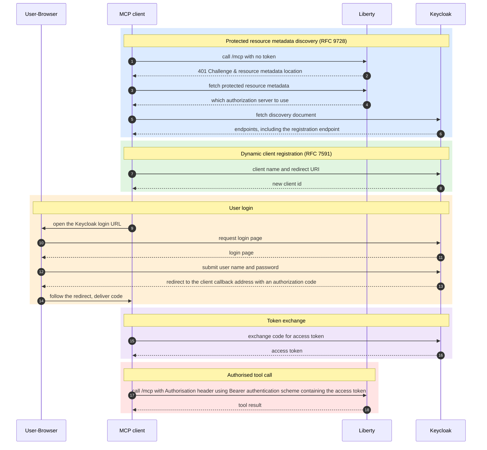

# Securing OpenLiberty MCP Server with OAuth and Keycloak

**OAuth & keycloak**

* OAuth is part of the [MCP spec](https://modelcontextprotocol.io/docs/2025-11-25/getting-started/intro), so MCP (Model Context Protocol) clients support logging in with OAuth.
* MCP requires that OAuth is used for authorization.
* To demonstrate OAuth, we need an authorization server that supports all of the OAuth features that MCP requires.
* For this demo we've picked Keycloak because it's free and supports everything we need.

**Our demo**

An AI assistant that can book a meeting room for you is useful. 
An AI assistant that allows anyone to impersonate you and book or cancel a room without your permission is a liability.

The moment an MCP server authorises a person to perform an action, it should know:
- who that person is (via a username) and
- what they are allowed to do (via a role) and
- that the person is who they say they are (authentication)

This blog explains how a hotel booking demo that we created does that and covers:
- the Open Liberty MCP server setup
- the Keycloak authorisation server setup
- how to get IBM Bob (the AI assistant) to trust the Open Liberty MCP Server and Keycloak  
- Java code demonstrating authorisation decisions
- the purpose of OAuth in authorisation

## Open Liberty

The security lives in two files. `server.xml` checks the token, and `web.xml` decides which roles may enter.

<!-- how to setup MCP Server -->

### Adding the required features

To enable security we need to add appSecurity & openidConnectClient-1.0 in the `server.xml`:
```xml
<featureManager>
    <platform>jakartaee-10.0</platform>
    <feature>mcp-1.0</feature>
    <feature>appSecurity</feature>
    <feature>openidConnectClient-1.0</feature>
</featureManager>
```

### Configuring liberty to accept OAuth access tokens

Open Liberty (in this example) is not configured to log users in or issue tokens itself.
Keycloak does that.

The `openidConnectClient` element configures Liberty so that:
- Liberty knows where to find Keycloak and
- Liberty knows which access tokens to accept and
- Liberty knows which claims are important to get roles for a user (in this case the roles are stored in the mcp-demo-server claim).
- Which servers Liberty has trusted to act as authorisation servers for the AI Assistants.
```xml
<openidConnectClient
    id="mcp-oidc-config"
    clientId="liberty-mcp-server"
    clientSecret="${OAUTH_CLIENT_SECRET}"
    discoveryEndpointUrl="https://localhost:8443/realms/liberty-demo/.well-known/openid-configuration"
    authFilterRef="mcp-auth-filter"
    signatureAlgorithm="FROM_HEADER"
    allowedSignatureAlgorithms="RS256"
    audiences="liberty-mcp-server"
    userIdentifier="preferred_username"
    inboundPropagation="required"
    tokenReuse="true">
    <protectedResourceMetadata advertisedScopes="mcp-demo-server,profile"/>
</openidConnectClient>

<authFilter id="mcp-auth-filter">
    <requestUrl urlPattern="/mcp" matchType="contains" />
</authFilter>
```
The authFilter expects access tokens to be present for URLs matching a specified pattern.
The specified pattern in the above case is `/mcp` and it must be present in the URL.

The settings that matter:
- `clientId` / `clientSecret`: Liberty's own identity in Keycloak. The secret comes from `server.env` so it is not committed in the XML.
- `discoveryEndpointUrl`: Liberty reads Keycloak's discovery document at startup and learns the token endpoint and signing keys.
- `allowedSignatureAlgorithms`: Keycloak's default token signing algorithm is RS256, so Liberty accepts access tokens signed with it. If the Keycloak signing algorithm changes, update it here as well.
- `audiences`: rejects any token whose `aud` claim does not include `liberty-mcp-server`. This stops a token issued for another service from working here.
- `userIdentifier`: maps the `preferred_username` claim to the Java principal, which is what `getUserPrincipal().getName()` returns.
- `inboundPropagation="required"`: Liberty accepts only tokens that the client already holds. It will never start a browser login itself.
- `protectedResourceMetadata`: publishes metadata telling MCP clients which authorization server and scopes to use. This is what makes the discovery sequence shown later possible.


### Configuring who can access the MCP server

There are two layers of authorisation here:
  - the `server.xml` asks "is the request for the right audience and is the access token valid?"
  - the `web.xml`    asks "is this users role authorised to access resources with the specified url-pattern?"
```xml
   1  <security-constraint>
   2      <web-resource-collection>
   3          <web-resource-name>All resources</web-resource-name>
   4          <url-pattern>/*</url-pattern>
   5      </web-resource-collection>
   6      <auth-constraint>
   7          <role-name>roomadmin</role-name>
   8          <role-name>roomuser</role-name>
   9      </auth-constraint>
  10  </security-constraint>
  11
  12  <security-role>
  13      <role-name>roomadmin</role-name>
  14  </security-role>
  15  <security-role>
  16      <role-name>roomuser</role-name>
  17  </security-role>
```
Lines 7,8,13,16 tell the MCP server which roles Sam needs to have in his token. 
If Sam doesn't have either the roomadmin or roomuser role in his access token then he cannot access any of the URLs that he needs on the MCP Server. 


## The Java


### Authorization Pattern 1 - Identity Check

The bookRoom tool (see java below) injects the HttpServletRequest (jakarta.servlet.http.HttpServletRequest).
Liberty reads the UserPrincipal.name field from the validated token (see line 17 below) to see which user was authorised to book the room. 
```java
   1  @ApplicationScoped
   2  public class RoomTools {
   3
   4      @Inject
   5      RoomService roomService;
   6
   7      @Inject
   8      HttpServletRequest httpRequest;
   9
  10      @Tool(description = "Book a room for a given time period",
  11            annotations = @Tool.Annotations(destructiveHint = false, openWorldHint = false))
  12      public String bookRoom(
  13              @ToolArg(name = "roomName") String roomName,
  14              @ToolArg(name = "start")  LocalDateTime start,
  15              @ToolArg(name = "end") LocalDateTime end) {
  16
  17          String bookedBy = httpRequest.getUserPrincipal().getName();
  18          boolean success = roomService.bookRoom(roomName, start, end, bookedBy);
  19
  20          if (success) {
  21              return "Room \"" + roomName + "\" successfully booked for " + bookedBy
  22                      + " from " + start + " to " + end + ".";
  23          } else {
  24              throw new ToolCallException("Failed to book room \"" + roomName + "\". "
  25                      + "The room may not exist or the requested time slot is already taken.");
  26          }
  27      }
  28  }
```

`getUserPrincipal().getName()` returns the `preferred_username` claim from the token (as shown in the `server.xml`). 
The booking is saved with the authorised user, namely Sam who initially booked a room through IBM Bob.

Failures are reported with `ToolCallException`, so the client receives a proper tool-level error instead of a generic server error.


### Authorisation Pattern 2 - Role check

The HttpServletRequest (jakarta.servlet.http.HttpServletRequest) is again injected by the getRoomBookingsOnDay tool.
Liberty uses the isUserInRole method to check if the authenticated user has the necessary role. 

See line 6 below which extracts the role information into the isAdmin boolean variable for an example of this.
```java
   1      @Tool(description = "Show all bookings for a room on a particular day",
   2            annotations = @Tool.Annotations(readOnlyHint = true, destructiveHint = false, openWorldHint = false))
   3      public String getRoomBookingsOnDay(
   4              @ToolArg(name = "roomName") String roomName,
   5              @ToolArg(name = "day") LocalDate day) {
              ...
   6          boolean isAdmin = httpRequest.isUserInRole("roomadmin");
   7          // ... filter the bookings for the day ...
   8          for (Room.BookingSlot slot : bookingsOnDay) {
   9              sb.append("  ").append(slot.getStart().toLocalTime())
  10                .append(" - ").append(slot.getEnd().toLocalTime());
  11              if (isAdmin) {
  12                  sb.append(" (booked by: ").append(slot.getBookedBy()).append(")");
  13              } else if (slot.getBookedBy().equals(httpRequest.getUserPrincipal().getName())) {
  14                  sb.append(" (booked by you)");
  15              }
  16              sb.append("\n");
  17          }
  18          return sb.toString().trim();
  19      }
```

### Authorisation Pattern 3 - Role and Identity check combined

The cancelBooking tool requires two checks:
- line 7 - Identity check
- line 8 - Role check
```java
   1      @Tool(description = "Cancel a room booking. ",
   2            annotations = @Tool.Annotations(openWorldHint = false))
   3      public String cancelBooking(
   4              @ToolArg(name = "roomName") String roomName,
   5              @ToolArg(name = "start") LocalDateTime start,
   6              @ToolArg(name = "end") LocalDateTime end) {
              ...
   7          String currentUser = httpRequest.getUserPrincipal().getName();
   8          boolean isAdmin = httpRequest.isUserInRole("roomadmin");
   9
  10          if (!isAdmin && !slot.get().getBookedBy().equals(currentUser)) {
  11              throw new ToolCallException("Not authorised");
  12          }
  13
  14          roomService.cancelRoom(roomName, start, end);
  15          return "Booking for room \"" + roomName + "\" from " + start + " to " + end + " has been cancelled.";
  16      }
```


## Keycloak


### Install Podman

Please see https://podman.io/docs/installation. 

### Run Keycloak

You will need to use `keytool` to create a CA certificate for Keycloak. 
With the docker-compose.yml file in the same directory run `podman compose up`
```YAML

services:
  keycloak:
    image: quay.io/keycloak/keycloak:26.7.3
    command: start-dev --verbose
    ports:
      - "127.0.0.1:8080:8080"
      - "127.0.0.1:8443:8443"
    environment:
      KC_BOOTSTRAP_ADMIN_USERNAME: admin
      KC_BOOTSTRAP_ADMIN_PASSWORD: admin
      KC_HTTPS_KEY_STORE_FILE: /custom-keys/localhost.p12
      KC_HTTPS_KEY_STORE_PASSWORD: ${keystore_password}
    volumes:
      - ./src/main/keycloak:/custom-keys:Z,U
```

The `${keystore_password}` value is read from a `.env` file next to `docker-compose.yml`, which `docker compose` and `podman compose` load automatically. `Setup.java` creates that file for you, and it is gitignored so the password is never committed.

This will download and run the keycloack image.

### Prerequisites

- Keycloak Admin is reachable at `https://localhost:8443/admin`. It uses a self-signed certificate, so accept the browser warning.
- You can log in to the **master** realm as `admin` with password `admin`.

The included [SetupLocalKeycloak.java](./SetupLocalKeycloak.java) JBang script performs the steps included below.
It uses the Keycloak Admin REST API so Keycloak and was tested on Mac OS. Please see https://www.jbang.dev/ for setup instructions.

### Create the realm

1. Click **Manage Realms** (top left, under _Current Realm_) → **Create realm**.
2. **Realm name:** `liberty-demo`
3. Make sure **Enabled** is on.
4. Click **Create**.

All following steps are done inside the `liberty-demo` realm. Select it in the realm dropdown.

### Create the realm roles

Go to **Realm roles** → **Create role**. Create two roles, each with just a name:

1. `roomuser`
2. `roomadmin`

### Create the client `liberty-mcp-server`

1. Go to **Clients** → **Create client**.
2. **General settings**
   - Client type: `OpenID Connect`
   - Client ID: `liberty-mcp-server`
3. **Capability config**
   - Client authentication: **On** (confidential client)
   - Authorization: Off
   - Authentication flow, tick all three:
     - **Standard flow**
     - **Direct access grants**
     - **Service accounts roles**
4. **Login settings**
   - Root URL: `https://localhost:9443/`
   - Home URL: `https://localhost:9443/`
   - Valid redirect URIs:
     - `https://localhost:9443/*`
5. Click **Save**. The client is enabled by default.

#### Capture the client secret

1. Open the client → **Credentials** tab.
2. Use the **Client secret**. This needs to be the same client secret as in the `server.xml` openidConnectClient config.

### Create the client scope `mcp-demo-server`

1. Go to **Client scopes** → **Create client scope**.
2. Fill in:
   - Name: `mcp-demo-server`
   - Type: **Default**
   - Protocol: `OpenID Connect`
   - Display on consent screen: **On**
   - Include in token scope: **On**
3. Click **Save**.

#### Add the audience mapper

1. Open the new scope → **Mappers** tab → **Configure a new mapper** → **Select "Audience"**.
2. Fill in:
   - Name: `MCP server audience`
   - Included Client Audience: `liberty-mcp-server`
   - Add to ID token: **On**
   - Add to access token: **On**
3. Click **Save**.

Tokens now carry `aud: liberty-mcp-server`, which Liberty checks through `audiences=` in `server.xml`.

#### Add the realm-role mapper

1. Same **Mappers** tab → **Configure a new mapper** → **User Realm Role**. Do not use "Add predefined mapper".
2. Fill in:
   - Name: `groups`
   - Token Claim Name: `groupIds`
   - Claim JSON Type: `String`
   - Multivalued: **On**
   - Add to ID token: **On**
   - Add to access token: **On**
   - Add to userinfo: **On**
3. Leave the other fields (Realm Role prefix, client ID) at their defaults.
4. Click **Save**.

Realm roles are now copied into a `groupIds` array. Liberty uses `groupIds` as its default group identifier, so `isUserInRole("roomadmin")` works in the tool beans.

#### Map the realm roles to the scope

1. Go to **Client scopes** → `mcp-demo-server` → **Scope** tab.
2. Click **Assign role**.
3. Filter by **realm roles**, select `roomuser` and `roomadmin`, then click **Assign**.

The client's "Full scope allowed" setting (**Clients** → `liberty-mcp-server` → **Client scopes** → `liberty-mcp-server-dedicated` → **Scope**) is left at its default.

### Create the users

Go to **Users** → **Add user**. Create both users with the values below.

> **Critical:** set email, first and last name. Keycloak's default user profile requires them.

| Field | `testadmin` | `testuser` |
|---|---|---|
| Username | `testadmin` | `testuser` |
| Email | `testadmin@example.com` | `testuser@example.com` |
| First name | `Test` | `Test` |
| Last name | `Admin` | `User` |
| Password | `testadmin123` | `testuser123` |
| Role | roomadmin | roomuser |

For each user:

1. Fill in the form with the values above → **Create**.
2. **Credentials** tab → **Set password**.
   - Enter the password and confirm it.
   - **Temporary: Off**.
   - Click **Save** and confirm.
3. **Role mapping** tab → **Assign role**.
   - Filter by realm roles, select the role from the table → **Assign**.


### Verify the access token

Request a token with the password grant and decode the access token at jwt.io:
```bash
curl -k -s -X POST \
  https://localhost:8443/realms/liberty-demo/protocol/openid-connect/token \
  -d client_id=liberty-mcp-server \
  -d client_secret=<CLIENT_SECRET> \
  -d username=testadmin \
  -d password=testadmin123 \
  -d scope=mcp-demo-server \
  -d grant_type=password
```
The decoded access token (see json below) should contain:

  • Line 7: aud includes liberty-mcp-server
  This means that this token is for the mcp-server only
  This should match openidConnectClient.audiences in the liberty `server.xml` otherwise Open Liberty will reject it. 
  
  • Line 36: scope includes mcp-demo-server
  This scope maps the Keycloak realm roles into groupIds
  
  • Lines 38–43: groupIds is a non-empty array containing roomadmin
  Open liberty only reads roles from groupIds. Open Libertie's web.xml must contain roomadmin, otherwise the MCP tools will not be called.
  
  • Line 45: preferred_username is testadmin 
  Open liberty uses this for for getUserPrincipal().getName()
```json
     1  {
     2    "exp": 1792674127,
     3    "iat": 1792673827,
     4    "jti": "onrtro:e9115a22-f5ec-8fa7-6a1f-d94e36a85a7d",
     5    "iss": "https://localhost:8443/realms/liberty-demo",
     6    "aud": [
     7      "liberty-mcp-server",
     8      "account"
     9    ],
    10    "sub": "33129343-2782-4417-9ece-34ae74ff6de1",
    11    "typ": "Bearer",
    12    "azp": "liberty-mcp-server",
    13    "sid": "ELvHGUKYoltrTYanEhiAAoHt",
    14    "acr": "1",
    15    "allowed-origins": [
    16      "http://127.0.0.1:6724",
    17      "https://localhost:9443"
    18    ],
    19    "realm_access": {
    20      "roles": [
    21        "default-roles-liberty-demo",
    22        "roomadmin",
    23        "offline_access",
    24        "uma_authorization"
    25      ]
    26    },
    27    "resource_access": {
    28      "account": {
    29        "roles": [
    30          "manage-account",
    31          "manage-account-links",
    32          "view-profile"
    33        ]
    34      }
    35    },
    36    "scope": "mcp-demo-server email profile",
    37    "email_verified": true,
    38    "groupIds": [
    39      "default-roles-liberty-demo",
    40      "roomadmin",
    41      "offline_access",
    42      "uma_authorization"
    43    ],
    44    "name": "Test Admin",
    45    "preferred_username": "testadmin",
    46    "given_name": "Test",
    47    "family_name": "Admin",
    48    "email": "testadmin@example.com"
    49  }
```

### Debugging

1. use Keycloak logs
2. use Bobs Debugging "Output" Window
3. use the curl command mentioned above
4. Press the Reset Auth button (in IBM Bob) to reset authentication (example for a new user)
5. Restart IBM Bob (sometimes this will show an Authenticate button in the MCP servers list when one was missing)
6. use IBM Bob to help you debug ;-)


### Letting clients register themselves

Because clients register at runtime, Keycloak's *client registration policies* have to allow it. They are under **Clients → Client registration** in the admin console, on the **Client registration policies** sub-tab, under **Anonymous access policies**. MCP clients register without credentials, so these are the policies that apply. By default Keycloak refuses anonymous registration. The demo changes two things:

- **Trusted Hosts**: the policy is deleted. It restricts registration to listed hosts, and keeping it means matching those hosts to the container runtime's networking. This is safe here only because Keycloak is bound to the loopback address. Anything reachable from a network should keep this policy and list its hosts.
- **Allowed Client Scopes**: `mcp-demo-server`, `profile`, `offline_access` are added so that registered clients may use them. A client asking for a scope outside this list is refused. The first three are what the demo needs. `offline_access` is there as a convenience, so that a client which asks for it is not refused.


##  IBM Bob Certificates

Since we're doing a local demo with self-signed certificates, we need to tell IBM Bob to trust the certificates for both Keycloak and the Liberty server. 
The certificates must be provided via the `NODE_EXTRA_CA_CERTS` environment variable, which every Node.js process respects automatically.

The fix for Windows is as follows:
Create a combined PEM bundle and set the variable permanently for your Windows user:
```bash
# Combine both certs into one bundle file
$liberty  = Get-Content "$CERTS_DIR\liberty-localhost.cer"
$keycloak = Get-Content "$CERTS_DIR\keycloak-localhost.cer"
($liberty + $keycloak) | Set-Content "$CERTS_DIR\local-ca-bundle.cer"

# Set permanently in your Windows user environment
[System.Environment]::SetEnvironmentVariable(
  "NODE_EXTRA_CA_CERTS",
  "$CERTS_DIR\local-ca-bundle.cer",
  "User"
)
```

**Fully restart Bob** (quit and relaunch) after setting this. The variable is only inherited\
by processes started after it is set.

Verify it is working before connecting Bob:

```bash
$env:NODE_EXTRA_CA_CERTS = "$CERTS_DIR\local-ca-bundle.cer"
node -e "
const https = require('https');
https.get('https://localhost:9443/my-app/mcp', (res) => {
  console.log('Status:', res.statusCode);
  console.log('WWW-Authenticate:', res.headers['www-authenticate']);
}).on('error', (e) => { console.log('Error:', e.message); });
"
# Expected: Status: 401 and a WWW-Authenticate header containing resource_metadata=
```

## What it looks like in use

Once connected to the MCP server in IBM Bob, use chat window to try:

- *What rooms are available tomorrow morning?*
- *Book a room for my 2pm meeting today.*

To see the role checks working, log in as `testuser` and book a room. Then connect as `testadmin` and list that room's bookings: the admin sees who made each booking, while `testuser` only sees "booked by you". `testadmin` can also cancel the booking, which an unrelated ordinary user could not.


## Running this in production 

This sections provides links to advice for hardening and production configuration considerations.

### Keycloak

[Configuring Keycloak for production](https://www.keycloak.org/server/configuration-production)

### Liberty

https://openliberty.io/docs/latest/security-hardening.html
https://openliberty.io/docs/latest/acme-cert-management.html


## The Purpose of OAuth

We use OAuth to stop unauthorised users from accessing protected resources on the MCP Server. 
We do this by configuring roles for users in:
- the Open Liberty MCP server 
- the Keycloak authorisation server

Users are assigned to roles. Roles are used to give users permission to do certain activities. 
Some are permissive, like a roomadmin role which lets you do almost anything.
Some are restrictive, like a roomuser which can only see or create bookings of their own. 

**High-level flow:**

The Keycloak admin securely stores a password for a user (Sam).
Open Liberty is setup to use Keycloak to allow Sam to do things on its MCP Server.
When the AI assistant tries to perform an action on behalf of Sam then:
- Keycloak first asks Sam for a password (covered in more detail later) and
- if the password is correct then
- Keycloak issues a token with permissions for the roles that the Sam is configured with.
- Sam uses this token to perform only authorised actions on the MCP server 
- The MCP server is the "_audience_" that the token is valid.

The AI Assitant (IBM Bob) only knows of the MCP server URL. 
Upon successful authentication, everything else is discovered.
Authentication with Keycloak needs to be initiated inside Bob. 

When Keycloak and the MCP server are configured and running, connecting Bob to the MCP Server is a simple process:
- Add the server to the client's MCP configuration, for example Bob's `.bob/mcp.json` (See json snippet below)
```json
{
  "mcpServers": {
    "booking-mcp-server": {
      "type": "streamable-http"
      "url": "https://localhost:9443/mcp"
    }
  }
}
```
- Locate the Bob MCP settings and find the booking-mcp-server entry.
- Click the **Authenticate** button next to the booking-mcp-server.


**Detailed flow**

Below is more detail sequence diagram of what will follow after the **Authenticate** button:



OAuth depend on a client ID/secret which usually are created manually.
Dynamic client Registration automates this so that AI assitants get credentials programmatically.


## Takeaways (Redo and check that it has the right focus)

- OAuth lets an AI client act for a person without ever holding their password, and lets the server see who is calling on every request.
- Keycloak plays the authorization server so that Liberty only has to validate tokens.
- On the Java side the cost is tiny: `getUserPrincipal()` and `isUserInRole()` on an injected request.
- Nearly all the difficulty is in configuration, in two places that fail silently: the scope type, and the role mapper type. Check the token before checking anything else.

## Further reading

### Open Liberty

- [Liberty MCP Server](https://openliberty.io/docs/latest/liberty-mcp-server.html)
- [Liberty MCP Server Security](https://openliberty.io/docs/latest/liberty-mcp-server-security.html)

### Model Context Protocol

- [Authorization](https://modelcontextprotocol.io/specification/2025-11-25/basic/authorization)
- [Security best practices](https://modelcontextprotocol.io/specification/2025-11-25/basic/security_best_practices)
- [Understanding authorization in MCP](https://modelcontextprotocol.io/docs/tutorials/security/authorization)

### Keycloak

- [Integrating with Model Context Protocol](https://www.keycloak.org/securing-apps/mcp-authz-server)


